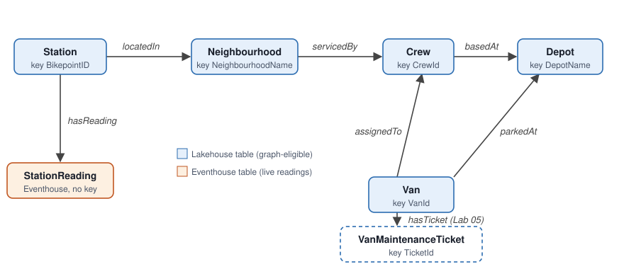

# IQRedo: Fabric IQ in two hours

A standalone, hands-on session on **Microsoft Fabric IQ**: build an **ontology** by hand, give it business meaning,
explore it as a **graph**, then put three kinds of agents on top of it: the **ontology agent**, a **data agent**
and an **operations agent**.

It's designed as the natural next step after a Real-Time Intelligence session (same bike-share world as the
[RTI Express labs](https://github.com/SQLClause/FabConBCNRTI-workshop/tree/main/RTI-Express)), but it **doesn't
depend on it**. Every item is created by hand in the Fabric portal, and every byte of data is a CSV in
[`data/`](data/) that you upload through the portal. No scripts, no CLI, no Azure resources, no shared
infrastructure.

## Scenario: the bike-share control room, now with business context

A London bike-share scheme has 72 docking stations in 12 neighbourhoods. Every station reports how many bikes and
empty docks it has, every minute. Six rebalancing crews, each based at a depot with its own vans, keep stations
from running empty or full.

Real-Time Intelligence can tell you *"BP-003 has had 0 bikes for 24 minutes"*. The control room needs *"Argyle
Street in Kings Cross, a Tier 1 area, has been empty for 24 minutes; it's North Loop's patch, their van leaves
from Kings Cross Depot, take V01 with 18 bikes, but V02 is off the road"*. That sentence needs **readings**
(Eventhouse), **master data** (Lakehouse), **relationships**, and **business rules**. The ontology is where those
come together, and every agent in this session reads from it.

## Agenda

| Time | Block | You build |
|---|---|---|
| 0:00 | **Kick-off** (talk, 10 min): why an ontology, where Fabric IQ sits next to RTI | |
| 0:10 | [Lab 01: Prepare the data](labs/lab-01-prepare-the-data.md) (15) | `BikeOpsLakehouse` with five tables, `BikeOpsEventhouse` with `StationReadings` |
| 0:25 | [Lab 02: Build the ontology by hand](labs/lab-02-build-the-ontology.md) (25) | `BikeOpsOntology`: six entity types, bindings, keys, six relationship types |
| 0:50 | [Lab 03: Give it business meaning](labs/lab-03-business-meaning.md) (12) | Descriptions, synonyms, property metadata, five business rules |
| 1:02 | [Lab 04: Explore the graph](labs/lab-04-explore-the-graph.md) (13) | Materialized graph, instances, a path query |
| 1:15 | [Lab 05: Ask, then extend, with the ontology agent](labs/lab-05-ontology-agent.md) (15) | The hero question; `VanMaintenanceTicket` added by the agent (Plan → Act) |
| 1:30 | [Lab 06: A data agent on top of the ontology](labs/lab-06-data-agent.md) (15) | `BikeOpsDataAgent` with the ontology as source |
| 1:45 | [Lab 07: An operations agent that watches](labs/lab-07-operations-agent.md) (10) | `BikeOpsOperationsAgent`, a simulated incident, a Teams message |
| 1:55 | **Wrap-up** (5) | |

Labs are strictly sequential, except that Lab 04 (graph) can be skipped without breaking Labs 05–07. Each lab ends
with a **Checkpoint**. Steps marked *(stretch)* aren't counted in the timings.

> 💡 **Lab 01 can be pre-work.** It's 15 minutes of data loading with no IQ content. If attendees do it before the
> session, they rerun one KQL block (K3) at the start and you gain 15 minutes for the agents.

## Prerequisites

Short version (details and the admin checklist in [`docs/prerequisites.md`](docs/prerequisites.md)):

- A Fabric workspace **per attendee** on a **paid capacity** (F2 or higher, or P1+). Trial capacities don't support
  operations agents, and Copilot-based features (ontology agent, data agent) need a paid capacity.
- Tenant settings on: *Users can create Fabric items*, *Users can create ontology (preview) items*, Copilot and
  Azure OpenAI, data agent, operations agent; plus cross-geo processing for AI if the capacity is outside the US
  and EU.
- Contributor (or higher) on the workspace.
- Microsoft Teams on the same account (Lab 07).
- The [`data/`](data/) folder on your laptop: **Code** → **Download ZIP** on this page, then unzip.
- A modern browser. Nothing to install.

## Fixed names

Used in every lab and artifact. If you rename something, rename it everywhere.

| Item | Name |
|---|---|
| Lakehouse | `BikeOpsLakehouse`, tables `stations`, `neighbourhoods`, `crews`, `depots`, `vans`, later `van_maintenance` |
| Eventhouse and KQL database | `BikeOpsEventhouse`, tables `StationReadingsRaw` (upload) and `StationReadings` (rebased to now) |
| Queryset | `BikeOpsEventhouse_queryset` (auto-created) |
| Ontology | `BikeOpsOntology`: entity types `Station`, `Neighbourhood`, `Crew`, `Depot`, `Van`, `StationReading`, later `VanMaintenanceTicket` |
| Relationship types | `locatedIn`, `servicedBy`, `basedAt`, `assignedTo`, `parkedAt`, `hasReading`, later `hasTicket` |
| Business rules | `Empty station`, `Needs rebalancing`, `Responsible crew`, `Bikes needed`, `Dispatchable van` |
| Data agent | `BikeOpsDataAgent` |
| Operations agent | `BikeOpsOperationsAgent` |

Status rules in the data: **Empty** = 0 bikes; **Full** = 0 empty docks; **Low** = under 20 % of capacity;
otherwise **OK**. Refill target: half full.

## Repository map

| Path | What's in it |
|---|---|
| [`labs/`](labs/) | The seven attendee labs |
| [`data/`](data/) | The seven CSV files attendees upload |
| [`artifacts/ontology-spec.md`](artifacts/ontology-spec.md) | Every entity type, binding, key, relationship, description and rule, to copy from |
| [`artifacts/BikeOpsEventhouse.kql`](artifacts/BikeOpsEventhouse.kql) | All KQL (K1–K8) |
| [`artifacts/agent-texts.md`](artifacts/agent-texts.md) | Questions, change request, agent instructions, and the **answer key** |
| [`docs/facilitator-guide.md`](docs/facilitator-guide.md) | Talk track, timing, room management, risks and fallbacks, dry-run checklist |
| [`docs/prerequisites.md`](docs/prerequisites.md) | Tenant, capacity and attendee checklist |
| [`tools/generate_data.py`](tools/generate_data.py) | Regenerates `data/` (standard-library Python). Not needed to run the session. |

## Wrap-up

What you built, in one line each:

1. **Data where it belongs**: master data in a Lakehouse, readings in an Eventhouse. Nothing copied into the
   ontology.
2. **An ontology**: business names for things, keys, and relationships instead of joins.
3. **Business meaning**: descriptions, synonyms and rules, written once, read by every agent.
4. **A graph**: multi-hop questions answered by following relationships.
5. **Three agents**: one that helps you build and evolve the model, one that answers questions for everybody, one
   that watches and recommends actions.

The point to take home: when an agent's answer is wrong, the fix is usually in the **model of the business**, not
in the prompt. Lab 05 showed it: same question, better answer, because the ontology learned about maintenance
tickets.

## Clean up after the session

Agents and graphs keep using capacity until you stop or delete them.

1. `BikeOpsOperationsAgent`: **Stop** (Lab 07 Part C).
2. Optional: delete the graph model, the agents, the ontology, the Eventhouse and the Lakehouse, or the whole
   workspace.

## Credits

Builds on the scenario of the RTI Express labs in
[SQLClause/FabConBCNRTI-workshop](https://github.com/SQLClause/FabConBCNRTI-workshop). Lab structure follows
Microsoft's [ontology tutorial](https://learn.microsoft.com/fabric/iq/ontology/tutorial-0-introduction); each lab
links the pages it adapts. All data is synthetic. Licensed under Apache 2.0.
