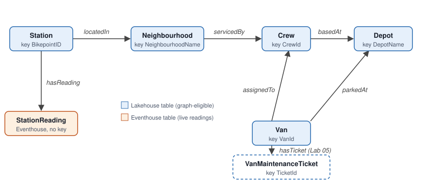

# BikeOpsOntology: the reference definition

Everything you type into the ontology in Labs 02, 03 and 05, in one place. Copy from here; the labs refer to the
tables by name. Names are case sensitive.

## Entity types (Lab 02)

| Entity type | Source item | Table | Entity type key | Graph? |
|---|---|---|---|---|
| `Station` | `BikeOpsLakehouse` | `stations` | `BikepointID` | Yes |
| `Neighbourhood` | `BikeOpsLakehouse` | `neighbourhoods` | `NeighbourhoodName` | Yes |
| `Crew` | `BikeOpsLakehouse` | `crews` | `CrewId` | Yes |
| `Depot` | `BikeOpsLakehouse` | `depots` | `DepotName` | Yes |
| `Van` | `BikeOpsLakehouse` | `vans` | `VanId` | Yes |
| `StationReading` | `BikeOpsEventhouse` (KQL database) | `StationReadings` | *none* | No: eventhouse sources can't be projected to the graph |

Keep every source column as a property (the default proposal). Don't rename properties.

## Relationship types (Lab 02)

Relationship names must be unique in the ontology (a duplicate name breaks natural-language queries in the
current preview).

| Relationship type | Origin entity type (property) | Target entity type (property) | Reads as |
|---|---|---|---|
| `locatedIn` | `Station` (`Neighbourhood`) | `Neighbourhood` (`NeighbourhoodName`) | A station is located in a neighbourhood |
| `servicedBy` | `Neighbourhood` (`CrewId`) | `Crew` (`CrewId`) | A neighbourhood is serviced by one crew |
| `basedAt` | `Crew` (`HomeDepot`) | `Depot` (`DepotName`) | A crew is based at a depot |
| `assignedTo` | `Van` (`CrewId`) | `Crew` (`CrewId`) | A van is assigned to a crew |
| `parkedAt` | `Van` (`DepotName`) | `Depot` (`DepotName`) | A van is parked at a depot |
| `hasReading` | `Station` (`BikepointID`) | `StationReading` (`BikepointID`) | A station has a reading every minute |

## Entity type metadata (Lab 03)

| Entity type | Description | Synonyms |
|---|---|---|
| `Station` | A public docking station where customers rent and return bikes. Capacity is the number of docks. | docking station, dock, bike point, bikepoint |
| `Neighbourhood` | An operational area of the city. Priority Tier 1 neighbourhoods require a response within 15 minutes; Tier 2 within 60 minutes. | area, district, zone |
| `Crew` | A rebalancing crew that moves bikes between stations and depots with vans. Each crew services its own neighbourhoods. | team, rebalancing crew, van crew |
| `Depot` | A depot where vans park and spare bikes are stored. | warehouse, base, yard |
| `Van` | A van that carries bikes between depots and stations. BikeCapacity is the number of bikes it can carry in one trip. | vehicle, truck, rebalancing van |
| `StationReading` | One reading per station per minute: how many bikes and empty docks the station has at that moment. Use the latest reading per station for "now" questions. | reading, telemetry, station status, occupancy |

## Property metadata (Lab 03)

| Entity type | Property | Description |
|---|---|---|
| `StationReading` | `No_Bikes` | Bikes available to rent at the station at this moment, including e-bikes. |
| `StationReading` | `No_EBikes` | Of No_Bikes, how many are e-bikes. |
| `StationReading` | `No_Empty_Docks` | Free docks where a customer can return a bike. |
| `StationReading` | `Status` | Empty = 0 bikes; Full = 0 empty docks; Low = under 20 % of capacity; otherwise OK. |
| `Van` | `VanStatus` | Available = parked at its depot and free to dispatch; InService = already out on a run. |
| `Station` | `Capacity` | Total number of docks at the station. |

## Relationship metadata (Lab 03)

| Relationship type | Description |
|---|---|
| `servicedBy` | The crew responsible for refilling and emptying every station in this neighbourhood. |
| `basedAt` | The depot a crew starts its shift from and returns bikes to. |
| `hasReading` | Minute-by-minute readings from the station's docks. |

## Business rules (Lab 03)

| Name | Definition | Linked ontology concepts |
|---|---|---|
| `Empty station` | A station is empty when its latest reading has No_Bikes = 0. A station has been empty for N minutes when every reading in the last N minutes has No_Bikes = 0. | Station, StationReading |
| `Needs rebalancing` | A station needs rebalancing when it has been empty for more than 15 minutes, or when its latest reading has Status Low and it is in a Tier 1 neighbourhood. | Station, StationReading, Neighbourhood |
| `Responsible crew` | The crew responsible for a station is the crew that services the station's neighbourhood. That crew's home depot is where the van leaves from. | Station, Neighbourhood, Crew, Depot |
| `Bikes needed` | Bikes needed to rebalance a station = round(Capacity × 0.5) − No_Bikes from its latest reading. A refill brings a station to half full. | Station, StationReading |
| `Dispatchable van` | A van can be dispatched when its VanStatus is Available. One van can carry up to BikeCapacity bikes per trip. | Van, Crew |

In Lab 05 the ontology agent changes `Dispatchable van` to: *A van can be dispatched when its VanStatus is
Available and it has no Open maintenance ticket with Severity High.* (linked concepts: Van, VanMaintenanceTicket).

## Added by the ontology agent (Lab 05)

| Entity type | Source item | Table | Entity type key |
|---|---|---|---|
| `VanMaintenanceTicket` | `BikeOpsLakehouse` | `van_maintenance` | `TicketId` |

| Relationship type | Origin entity type (property) | Target entity type (property) |
|---|---|---|
| `hasTicket` | `Van` (`VanId`) | `VanMaintenanceTicket` (`VanId`) |
